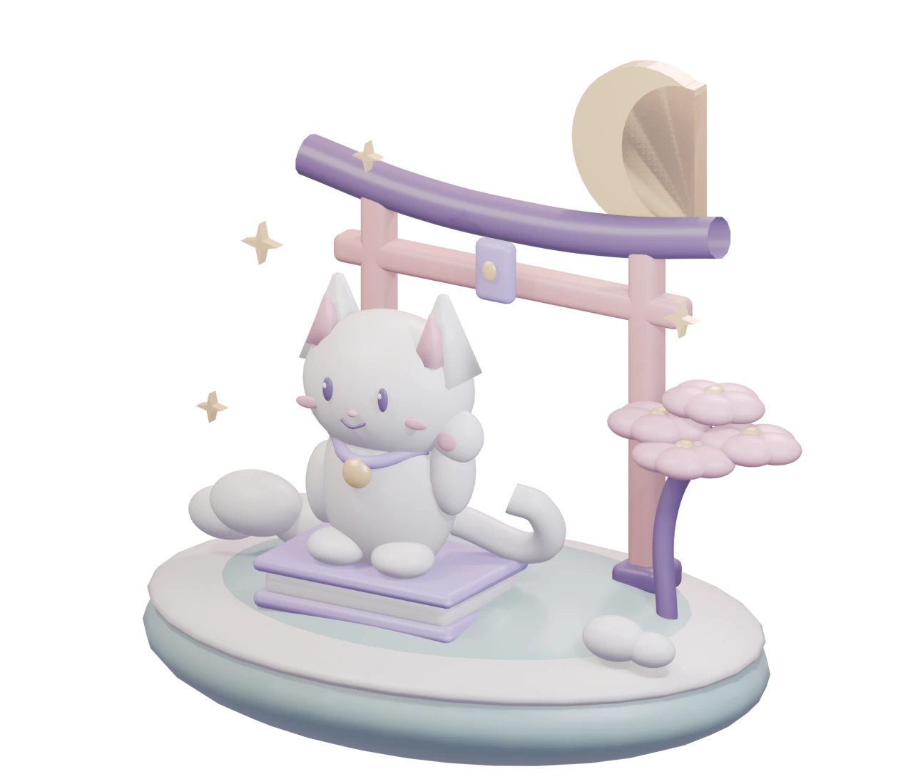

# 🌸 Hikari

**Your anime companion for Discord communities.**

[Invite Hikari](https://discord.com/oauth2/authorize?client_id=1562836610800685118&scope=bot%20applications.commands&integration_type=0&permissions=1409021242582) · [Open the bot hub](https://itay123458.github.io/Hikari/) · [Source code](https://github.com/itay123458/Hikari)

<p align="center"><a href="https://itay123458.github.io/Hikari/"></a></p>

Hikari brings anime discovery, private watchlists, airing schedules, watch
parties, and community activities into one Discord bot. Built for Silver
Palace, it can also be invited to your own server. The focused command set
includes essential moderation, music, roles, and welcome tools.

The public **[Hikari hub](https://itay123458.github.io/Hikari/)** includes an
interactive command library, server setup guide, privacy information, and an
original Blender scene you can explore in 3D. Server configuration stays inside
Discord. Use `/help` or `/anime help` to get started.

To invite the hosted bot, choose **Invite Hikari** above and select a server you
manage. The invite requests feature permissions without Administrator. Run
`/configwizard` for the basics, then `/anime admin` for anime channels and club
settings. The Silver Palace channel/role layout is a server-specific example;
inviting Hikari does not automatically copy it to another server.

## What Hikari does

| Feature | What you can do |
| --- | --- |
| Discover anime | Search and filter titles, explore seasons, browse character and voice credits, and open provider-listed official streaming links |
| Track your watching | Keep a private watchlist, record episode progress, rate shows, save episode notes, and view personal statistics |
| Find your next show | Get suggestions based on recorded preferences/history, compare with consenting members, and pick from your own list |
| Follow releases | Browse raw/sub/dub schedules, view mapped episode countdowns, and follow releases privately or for the club |
| Watch together | Create watch parties with RSVP, opt-in private reminders, episode discussions, reviews, and anime hubs |
| Play and vote | Run anime guessing games, character tournaments, and persistent club polls |
| Keep conversations moving | Post optional, spoiler-free conversation starters at a configurable interval, without mass pings |
| Run the palace | Use essential moderation, music controls, welcome settings, role menus, logging, and member/server tools |

## Start here

```text
/anime help
/anime discover search
/anime list add
/anime list show
/anime alerts schedule
/anime club party
/anime club poll
/anime games guess
```

Use Discord's command picker for the required options. Anime actions use slash
commands; supported general commands also work with the configured prefix.

## The active command set

Hikari registers **29 top-level commands**. The complete anime suite sits under
`/anime`, organized into `discover`, `list`, `alerts`, `club`, `games`, and `admin`.

| Purpose | Commands |
| --- | --- |
| Anime | `/anime` |
| Help, configuration, and status | `/help`, `/commands`, `/configwizard`, `/ping`, `/stats` |
| Music | `/play`, `/queue`, `/nowplaying`, `/music` |
| Moderation | `/ban`, `/unban`, `/kick`, `/timeout`, `/untimeout`, `/purge`, `/warn`, `/warnings`, `/cases`, `/lock`, `/unlock` |
| Roles, welcomes, and logs | `/reactroles`, `/logging`, `/welcome`, `/greet` |
| Member and server tools | `/avatar`, `/userinfo`, `/serverinfo`, `/report` |

Staff commands keep their permission checks. Economy, gambling, tickets,
leveling, giveaways, and unrelated legacy tools are outside the active command
set. Their existing stored data is preserved.

See the [command catalogue](docs/COMMANDS.md) and
[full anime guide](docs/ANIME.md) for behavior, options, and limitations.

## Privacy and spoilers

- Watchlists, ratings, and episode notes are private by default.
- Shared comparisons require both members' current consent in that server.
- Reviews are explicit public contributions. Review text is revealed privately
  after an episode-context/spoiler warning when needed.
- Anime data can be exported or deleted with `/anime list export` and
  `/anime list delete`.
- Party reminder DMs require an affirmative RSVP. Inactivity reminder DMs are
  optional and can be disabled.
- Synopses are hidden by default. Discord spoiler labels and tags still matter:
  ordinary discussion threads do not enforce access based on viewing progress.

## Private club roles

| Role | Purpose |
| --- | --- |
| Palace Member | Approved club access, chat/media, polls, threads, voice, streaming, and voice activities |
| Event Host | Club access, event management, and announcement posting |
| Palace Guardian | Club/staff access, warnings and timeouts, message/thread cleanup, case viewing, and voice moderation |
| Interest and genre roles | Optional cosmetic labels; no membership or staff powers |
| Palace Veteran | Manually awarded cosmetic recognition; no extra permissions |

New arrivals can read welcome and rules while awaiting approval. Staff rooms
stay private, and feed/archive channels stay read-only. Membership approval and
invitations remain owner/admin-controlled. Role menus refresh permission data
and reject roles with staff powers.

See [server roles and channel permissions](docs/SERVER-ROLES.md) for the full model.

## Conversation starters

Silver Palace uses a **two-day interval** in anime-chat. Prompts are original,
spoiler-free questions with no mass pings or automatic DMs. They use the server's
time zone and an evening window of **18:30–21:30**, subject to quiet hours.
The default time zone is `Asia/Jerusalem`.

Administrators can configure this with:

```text
/anime admin channels conversation:#anime-chat
/anime admin feeds prompt-days:2
```

Set `prompt-days:0` to disable. The feature defaults off for an unconfigured
server. Reservations and delivery receipts persist in PostgreSQL; expired-day
jobs are skipped rather than posted in a catch-up burst after downtime.

## Maintainer setup

Requirements: **Node.js 20.10+**, PostgreSQL, and a Discord bot application.
Music additionally needs a working Lavalink v4 node. Enable **Server Members**
and **Message Content** privileged intents for the current bot configuration.

From an authorized checkout:

```sh
npm ci
cp .env.example .env
```

Fill `.env` privately. At minimum, configure:

| Setting | Purpose |
| --- | --- |
| `DISCORD_TOKEN` | Hikari's Discord bot token |
| `CLIENT_ID` | The same Discord application's ID |
| `OWNER_IDS` | Comma-separated Discord IDs for bot owners |
| `POSTGRES_URL` | The persistent PostgreSQL connection string |
| `ANIMESCHEDULE_TOKEN` | AnimeSchedule application bearer token for schedules |
| `PORT` | Health/API listening port |

Keep `.env` and database backups out of Git. Before changing an existing
installation, back up its database. Then validate the schema and start:

```sh
npm run migrate
npm run migrate:check
npm start
```

Use `/configwizard` for server setup and `/anime admin` to select channels,
modules, title language, time zone, spoiler behavior, and optional feeds.

For the isolated Docker deployment, use the
[Raspberry Pi deployment guide](docs/DEPLOYMENT-PI.md). The `/health` and `/ready`
endpoints report service and persistent-database readiness.

## Data sources and availability

**Jikan v4** supplies MyAnimeList metadata and needs no API key.
**AnimeSchedule** supplies release schedules and needs an application token.
Provider availability and rate limits can affect features.

Crunchyroll integration opens provider-listed official links. Hikari does not
sign into Crunchyroll, confirm regional availability/languages, or guarantee
that an episode has been published. Music availability depends on Lavalink
and the selected audio source.

## Development checks

```sh
npm run check
npm test
```

Tests cover private anime workflows, spoiler controls, persistent scheduling,
duplicate-delivery protection, role-menu safety, and the active command/help
catalogue. An additional concurrency check can use a disposable PostgreSQL
instance through `TEST_POSTGRES_URL`.

## Credits

Hikari builds on TitanBot by **codebymitch**. Original copyright notices and
the [MIT license](LICENSE) are retained. Repository visibility does not change
those upstream license notices.

## Public hub development

Run `npm ci` and `npm run build:site`, then serve the `site/` directory with a
static HTTP server. The build derives its 29-command, 107-entry catalogue from
the active command loader and copies only public names, descriptions, categories,
and links. No bot login or secrets are needed to build the hub.

GitHub Actions deploys only `site/` to GitHub Pages on pushes to `main`.
The original artwork, editable Blender file, and reproducible generator live in
[`design/`](design/README.md). The optional 3D viewer uses model-viewer 4.4.0;
text and static artwork remain usable when it cannot load. Fonts use Google
Fonts with local fallbacks. No analytics are added.
